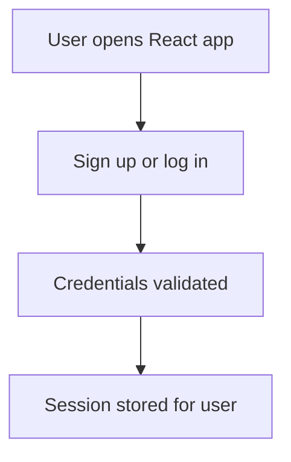
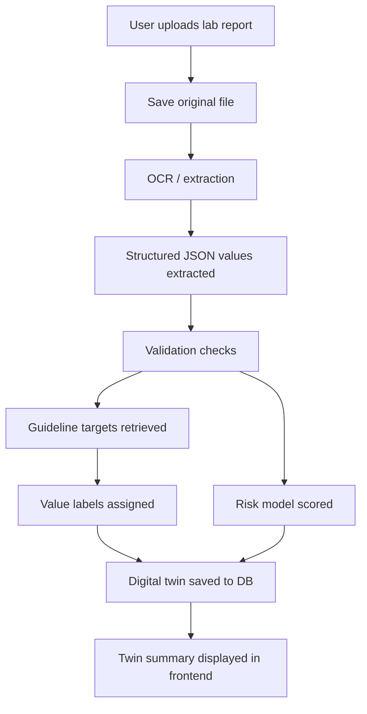
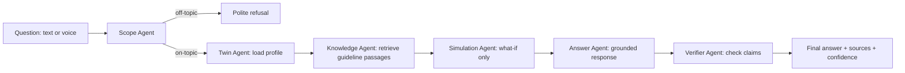
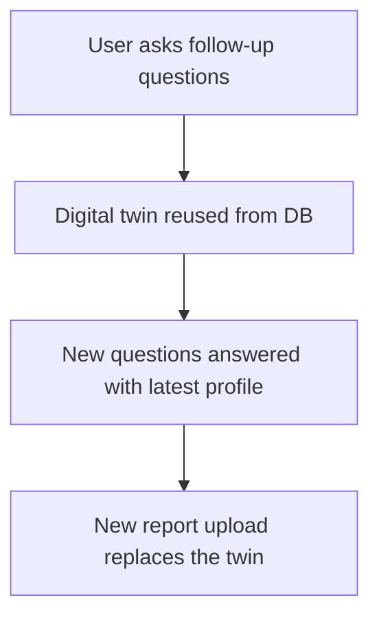

# MedTwin

### AI-Powered Digital Twin for Type 2 Diabetes

> Personalized health insights powered by a patient digital twin, guideline-grounded retrieval, and a trained risk model artifact.

MedTwin is an educational full-stack AI application that creates a digital twin of an adult with Type 2 Diabetes from health and lab values. It combines patient-specific data with retrieved clinical guideline passages and a stored machine-learning risk model to answer diabetes questions and what-if scenarios.

This project is not a Streamlit app. The frontend is a React + Vite web app, and the backend is a Python FastAPI service.

> Educational demo only: MedTwin is not a medical diagnostic system and should not be used for real clinical decisions.

---

## Project architecture

```text
Patient Report / Input
        ↓
React Frontend (Vite)
        ↓
FastAPI Backend
        ↓
Digital Twin Builder
        ↓
Risk Model + Guideline Retrieval
        ↓
LLM Answer + Verifier
        ↓
Final Response + Sources + Confidence
```

---

## Frontend

The UI is built with React and Vite in `frontend/`.

Typical setup:

```bash
cd frontend
npm install
npm run dev
```

This frontend handles authentication, profile flows, uploads, chat, digital twin views, and the patient experience.

---

## Backend

The backend is a Python FastAPI app in `backend/`.

Typical setup:

```bash
cd backend
python -m venv .venv
.venv\Scripts\Activate.ps1
pip install -r requirements.txt
uvicorn main:app --reload
```

The backend includes:
- authentication and user management
- twin creation and profile persistence
- AI chat orchestration
- speech transcription/synthesis endpoints
- guideline search and answer verification

---

## Full workflow

### Phase 1 — Account access



### Phase 2 — Build the digital twin



### Phase 3 — Answer questions



### Phase 4 — Repeat use



---

## Core features

### Digital twin

Creates a structured patient profile containing fields like:

- age
- sex
- BMI
- blood pressure
- cholesterol
- HDL
- creatinine
- insulin status
- HbA1c
- risk score and percentile
- guideline-based status labels

Each value can be flagged as:

```text
✓ At Goal
⚠ Needs Attention
```

### Risk model

The project includes a saved risk-model artifact and supporting analysis scripts in `training/`, such as:

- `risk_model.joblib`
- calibration and analysis outputs
- model training/reference utilities

This is part of the application’s supporting pipeline and experimentation assets. However, the main product is the full-stack app itself, not a model-training platform or a live training workflow.

### Guideline-grounded retrieval

Medical reasoning is grounded in retrieved guideline passages rather than free-form model generation alone.

Relevant passages may come from sources such as:

- ADA Standards of Care
- NICE guidance
- WHO HEARTS-D sources
- diabetes consensus material

### What-if simulation

Users can ask questions like:

```text
What if my HbA1c remains high for 6 months?
What if my BMI decreases?
```

The simulation layer modifies the relevant digital-twin value and re-runs the applicable risk logic to show a before/after estimate.

---

## Model and training notes

The repository contains a `training/` directory with scripts and exported artifacts that were used to build and validate the risk model. These files are support assets for the system and may be useful for local analysis or reproducibility.

The app itself does not perform model training at runtime. In other words:

- no training loop is run during normal app use
- the system consumes a stored model artifact rather than retraining on each request
- the README should describe the project as an AI application with supporting model artifacts, not as an ongoing training project

---

## Repository structure

```text
MedTwin/
├── backend/
│   ├── agents/
│   ├── model/
│   ├── rag/
│   ├── main.py
│   └── ...
├── frontend/
│   ├── src/
│   ├── public/
│   ├── server.ts
│   └── ...
├── training/
│   ├── outputs/
│   ├── train_model.py
│   └── ...
├── readme.md
├── MedTwin_Build_Guide.md
├── requirements.txt
└── ...
```

---

## Important note

This project is an educational demo and is not intended for real clinical decision-making.

